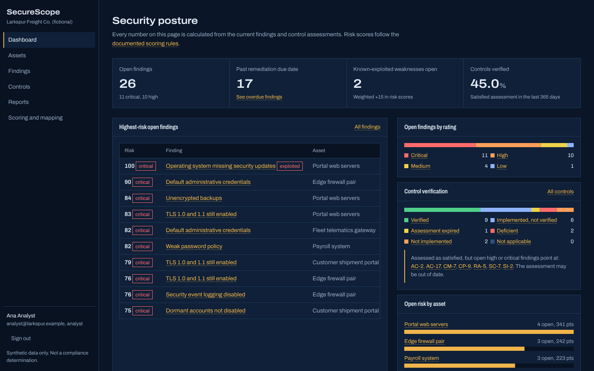
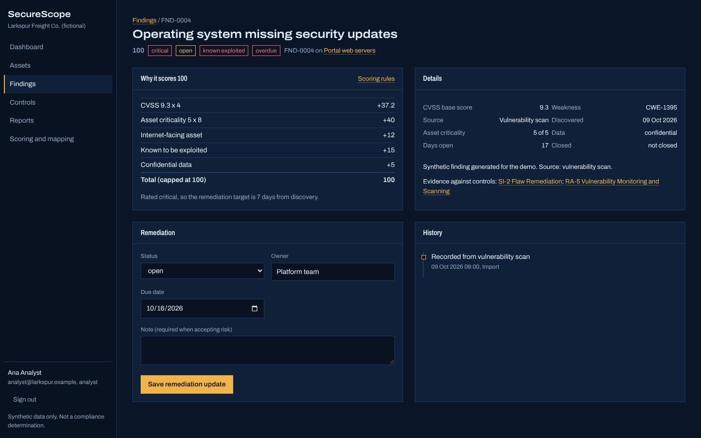
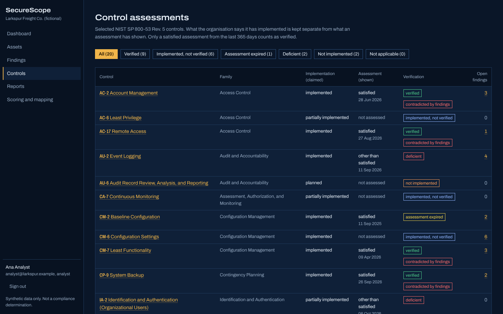
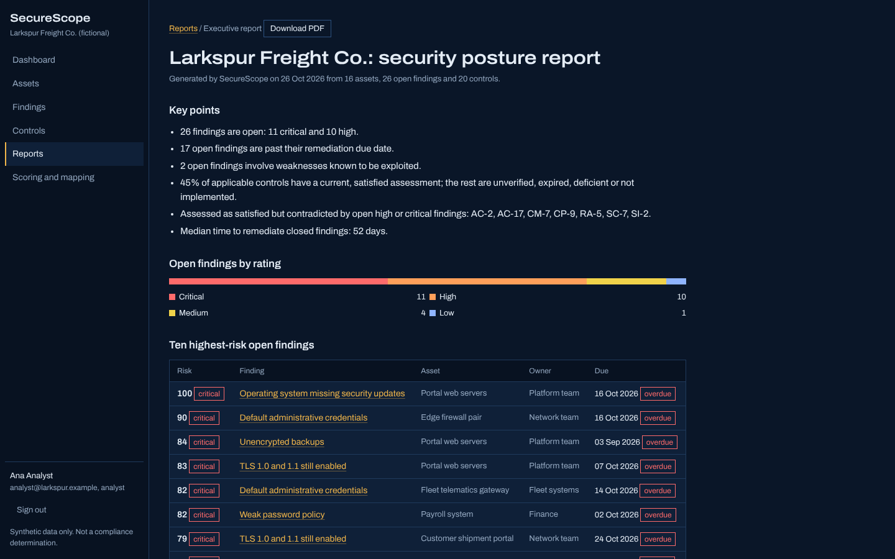
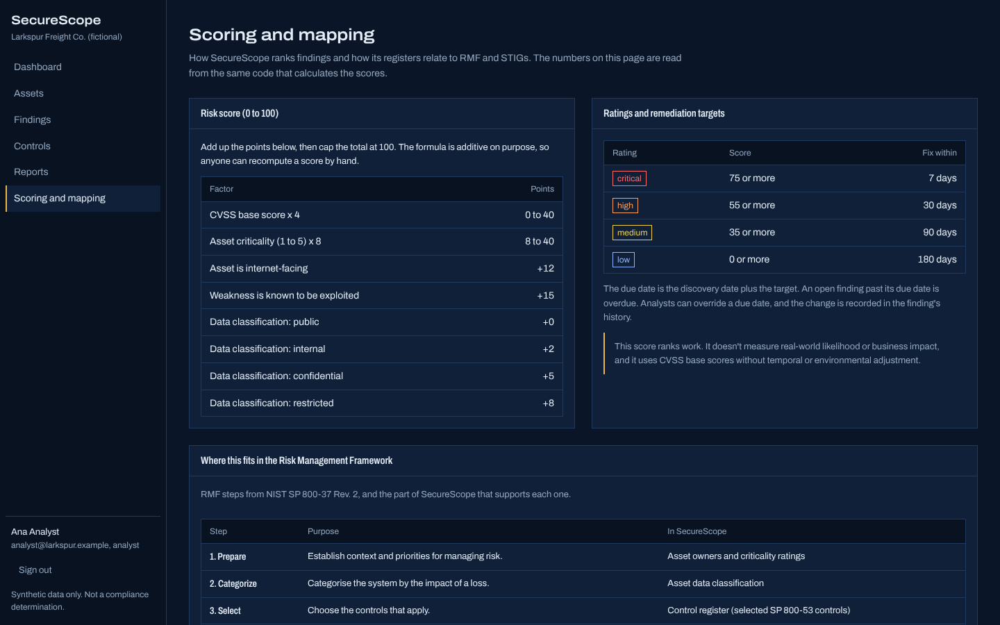
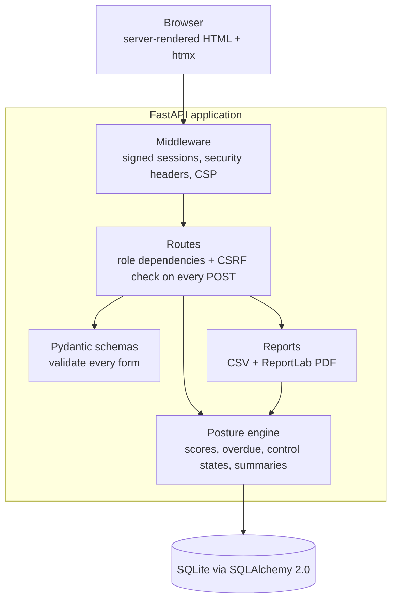

# SecureScope

**A security posture and control assessment dashboard.** SecureScope brings an organisation's assets, vulnerability findings, risk scores, NIST SP 800-53 control assessments and remediation work into one place. It turns all of that into an executive report generated from the live data.



> **Demonstration only.** All data describes *Larkspur Freight Co.*, a fictional company, and is generated synthetically. SecureScope doesn't scan anything, connect to any real system, or establish compliance with any framework. A dashboard can show recorded evidence. It can't decide whether a system is secure or authorised.

## The problem

Security teams usually keep vulnerability data, asset criticality and control assessments in separate places: a scanner, a spreadsheet and an audit binder. That separation causes three recurring mistakes:

1. **Ranking by CVSS alone.** A 9.8 on a forgotten staging box gets fixed before a 7.5 on the internet-facing payment system.
2. **Treating "implemented" as "verified."** A control that someone *says* is in place gets reported as if an assessment had *shown* it works.
3. **Assessments going stale unnoticed.** A control assessed as satisfied last year still shows as green, even while open findings say otherwise.

SecureScope tackles each one directly: a transparent risk score that weighs business context, separate fields for claimed and demonstrated control status, and automatic flags for expired or contradicted assessments.

**Intended users:** security analysts who triage and track remediation, control owners who record assessments, and leaders who need a short, honest summary.

## Features

- **Asset inventory** with configurable criticality (1 to 5), data classification and internet exposure. Change them and every affected finding is re-scored.
- **Vulnerability register** with search, filters (rating, status, asset, overdue) that update in place with HTMX, CWE, source, related controls and CSV export.
- **Transparent risk scoring.** Each finding shows exactly which factors added which points. See [docs/risk-scoring.md](docs/risk-scoring.md).
- **Remediation tracking:** owner, status, due dates computed from rating-based targets, overdue flags, and a history of every change. Accepting a risk requires a written justification.
- **Control assessment register** for 20 selected SP 800-53 Rev. 5 controls, separating *implementation (claimed)* from *assessment result (shown)*, with expiry after 365 days.
- **Contradiction detection:** controls assessed as satisfied but referenced by open high or critical findings are flagged.
- **RMF and STIG mapping view** that shows where each RMF step is supported and how STIG severity categories relate to findings. It's clearly labelled as illustrative, not an official crosswalk.
- **Executive report** as a printable page and a generated PDF, built from live data, with a limitations statement. A sample generated from the demo data is in [docs/sample-executive-report.pdf](docs/sample-executive-report.pdf).
- **Role-based access:** viewers can read, analysts can update findings and assessments, and admins manage assets and demo data.

<table>
<tr>
<td></td>
<td></td>
</tr>
<tr>
<td></td>
<td></td>
</tr>
</table>

## Architecture



| Module | Responsibility |
|---|---|
| `app/scoring.py` | Pure risk-scoring functions and constants |
| `app/controls.py` | Control catalog, verification classification, RMF and STIG reference data |
| `app/posture.py` | Joins the records into scored findings, control views and dashboard summaries. Nothing derived is stored |
| `app/security.py` | Argon2id hashing, login throttling, CSRF, role dependencies |
| `app/schemas.py` | Validation rules for every form |
| `app/reports.py` | CSV exports with injection protection, and the executive PDF |
| `app/routes/*` | Thin HTTP handlers |

### Technology choices

| Choice | Why |
|---|---|
| FastAPI + Jinja2 + htmx | Server rendering keeps authentication in one place (session plus CSRF token) and allows a strict CSP. htmx adds in-place filtering without a JavaScript build |
| SQLAlchemy 2.0 + SQLite | Typed models and portable SQL. One file is enough for a demo, and moving to PostgreSQL is a configuration change |
| Pydantic v2 | Declarative, testable validation with readable error messages |
| argon2-cffi | Argon2id is the current OWASP-recommended password hash |
| ReportLab | Pure-Python PDF generation with no system dependencies |

## Getting started

Requirements: Python 3.11 or newer.

```bash
git clone https://github.com/<your-username>/securescope.git
cd securescope
python -m venv .venv && source .venv/bin/activate
pip install -r requirements.txt && pip install -e ".[dev]"
cp .env.example .env          # optional for local use
python -m app                 # http://127.0.0.1:8000
```

On first start the database is created at `./data/securescope.db` and seeded. Sign in with one click as a demo **viewer**, **analyst** or **admin**. You can also use the email and password form: `analyst@larkspur.example` with the demo password from `.env` (the default is `securescope-demo`).

### Docker

```bash
docker build -t securescope .
docker run -p 8000:8000 -v securescope-data:/data \
  -e SECURESCOPE_SECRET_KEY="$(python -c 'import secrets; print(secrets.token_urlsafe(48))')" \
  securescope
```

The container runs as a non-root user and has a health check. It **won't start** without a secret key.

## Testing and quality checks

```bash
pytest --cov=app        # 59 tests, about 95% line coverage
ruff check . && ruff format --check .
mypy app                # strict mode
bandit -r app -c pyproject.toml
pip-audit -r requirements.txt
```

The tests cover the scoring rules and rating boundaries, control classification, password hashing and lockout, and every role restriction. They also check CSRF enforcement, open-redirect protection, the fail-closed start-up check, validation errors, re-scoring when asset criticality changes, history recording, the CSV and PDF exports, formula-injection handling, and that dashboard figures agree with the raw data.

[GitHub Actions](.github/workflows/ci.yml) runs all of these on every push. It then builds the container and checks two things: that it refuses to start without a secret, and that it serves its health check when given one.

## Deployment (free tier)

1. Push to GitHub.
2. On [Render](https://render.com), create a **Web Service** from the repository using the Docker runtime.
3. Set `SECURESCOPE_SECRET_KEY` to a long random value. Leave `SECURESCOPE_DEMO_MODE=true` for a public demo.
4. Render's free tier has no persistent disk, so the data resets to the seed on each restart. That suits a public demo. Free instances also sleep when idle, so the first request after a while is slow.

## Security

See the [threat model](docs/threat-model.md) and the [security design review](docs/design-review.md). In summary:

- Argon2id password hashing, per-account lockout, uniform error messages and timing-equalised lookups
- Signed `HttpOnly`, `SameSite=Lax` session cookies (`Secure` in production), regenerated on sign-in
- A CSRF token on every state-changing request
- Role checks enforced on the server in route dependencies
- A strict Content Security Policy with no inline scripts or styles, plus `X-Frame-Options`, `nosniff` and HSTS in production
- Parameterised queries only, and Pydantic validation on every input
- Pinned dependencies, `pip-audit`, Bandit and strict mypy in CI

## Limitations

- The data is synthetic, and the risk score hasn't been validated against real incident data.
- Only 20 SP 800-53 controls are included, with no control enhancements or baselines.
- The RMF and STIG view is illustrative. SecureScope doesn't import STIG checklists, CCIs or scanner output.
- Login throttling is in memory, which suits one instance only. There's no MFA.
- Changes to control assessments aren't yet recorded in an audit history.
- SQLite isn't suitable for many concurrent writers.

## Roadmap

- Import findings from scanner exports (CSV and SARIF)
- MFA for analyst and admin accounts
- An audit history for control assessments
- Trends over time (snapshots of posture metrics)
- PostgreSQL support in the Docker Compose setup

## License

MIT. See [LICENSE](LICENSE). htmx is included under its own licence (`app/static/htmx-LICENSE.txt`), and the Archivo font under the SIL Open Font License (`app/static/fonts/OFL-Archivo.txt`).
