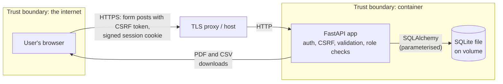

# Threat model

**Scope:** the SecureScope web application as deployed from this repository: one container running FastAPI, with a SQLite file on a volume, behind a TLS-terminating host such as Render.
**Method:** STRIDE applied to each element of the data-flow diagram below.
**Last reviewed:** October 2026, against version 1.0.0.

## What we're protecting

| Asset | Why it matters |
|---|---|
| Finding and asset records | In a real deployment, these would show attackers exactly where an organisation is weak. Even in the demo, the confidentiality design must hold |
| Control assessment records | Altering them could hide deficiencies or fake verification |
| User credentials and sessions | Taking over an account lets an attacker read or change everything above |
| Audit history of findings | Accountability for risk-acceptance decisions |

## Data flow

## STRIDE analysis

| # | Threat | Element | Mitigation in this codebase | Residual risk |
|---|---|---|---|---|
| S1 | Password guessing or credential stuffing | Sign-in | Argon2id hashing. Per-account lockout after 5 failures in 15 minutes. The error message doesn't say which part was wrong, and unknown emails run a dummy hash so timing gives nothing away | The lockout is in memory and per process. There's no IP-based limiting and no MFA |
| S2 | Session hijacking | Session cookie | Signed cookie (itsdangerous), `HttpOnly`, `SameSite=Lax`, `Secure` in production, and an 8-hour lifetime. The session is regenerated on sign-in to prevent fixation | A stolen cookie works until it expires; there's no server-side revocation list |
| S3 | Demo sign-in abused in production | `/demo-login` | Only active when `SECURESCOPE_DEMO_MODE=true`. Otherwise it returns 404 and the buttons are hidden | An operator could leave demo mode on by mistake. This is documented in the README |
| T1 | Cross-site request forgery | Every POST | A per-session CSRF token is required on every state-changing route, through a form field or an HTMX header, and compared in constant time. SameSite cookies add a second layer | None significant |
| T2 | SQL injection | Database | Only SQLAlchemy ORM and parameterised queries. No string-built SQL | None significant |
| T3 | Tampering with assessments | Controls | Changes need the analyst role. Validation stops a result being recorded without a date, or with a future date | Control assessment edits aren't written to an audit history (findings' edits are). This is on the roadmap |
| T4 | Formula injection through CSV exports | Reports | Cells that start with `= + - @` or a tab are prefixed with `'` | None significant |
| R1 | Denying a risk-acceptance decision | Findings | Accepting a risk requires a note. Every status, owner and due-date change is written to the finding's history with the user and time | The history is stored in the same database an admin can reset, so it isn't tamper-evident |
| I1 | Cross-site scripting reveals data | All pages | Jinja2 autoescaping. A strict CSP (`script-src 'self'`, no inline scripts or styles). `X-Content-Type-Options` | None significant |
| I2 | Clickjacking | All pages | `frame-ancestors 'none'` and `X-Frame-Options: DENY` | None |
| I3 | Error messages leak internals | Errors | A generic 500 page. Details go to server logs only. The OpenAPI docs UI is disabled | None significant |
| I4 | Open redirect after sign-in | `next` parameter | Only local paths are accepted (no scheme, host or `//`) | None |
| D1 | Large request bodies | Forms | Field length limits, and multi-select fields validated against the catalog | There's no global body-size limit in the app; that's left to the host or proxy |
| D2 | Expensive pages | Dashboard, reports | Data volumes are small, and summaries are computed in one pass | At real scale, summaries would need caching or pre-aggregation |
| E1 | A viewer performs analyst actions | Routes | Role checks happen in route dependencies on the server, not just by hiding buttons. Tests confirm 403s | None significant |
| E2 | Running with a weak secret key | Config | Start-up fails outside development if the default key is still set. CI tests this | The operator still has to choose a strong key |

## Out of scope

- Compromise of the hosting provider or the container runtime.
- Supply-chain attacks on dependencies. These are reduced by pinned versions, `pip-audit` and Bandit in CI, but not eliminated.
- Physical and social-engineering attacks.

## Follow-up actions

1. Add MFA (TOTP or WebAuthn) for admin and analyst roles.
2. Move login throttling to a shared store, and add IP-based limits.
3. Write control-assessment changes to an append-only audit table.
4. Add server-side session revocation, so admins can force sign-out.
